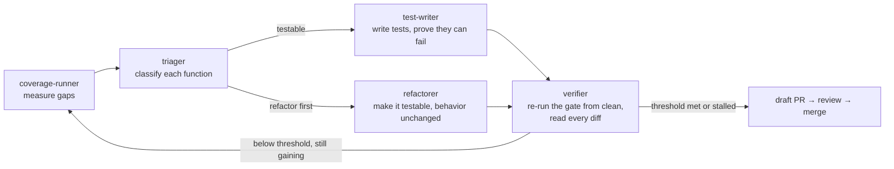

# screen-savers: an agent harness for legacy-code modernization

This repository holds the harness, coverage data and engineering record behind the modernization of three legacy macOS screen savers: [Hyperspace](https://github.com/fiazsami/hyperspace), [Helios](https://github.com/fiazsami/helios) and [Hills](https://github.com/fiazsami/hills). They are written in C++, Objective-C and OpenGL. The harness is a team of Claude Code agents with fixed roles, guard hooks with their own tests, a line-coverage ratchet, and a pull request for every change.

> **Status:** this is a first build of the harness, made in August 2026 and kept as built. The [lessons](docs/lessons/) record what did not work the first time.

Over three days (21–23 August 2026) it produced:
- **204 commits, merged through 88 pull requests** across the four repositories; after the first 85 minutes of setup, nothing was committed directly to a default branch;
- line coverage of the shared C++ core in Hyperspace and Helios from **5.4% to 96.5%** (2,388 lines, [baselines](coverage/));
- test suites of **189, 198 and 11 cases** in the three savers (the Hyperspace and Helios suites overlap, because they test the same core), and **161 tests** for the harness itself;
- **eight defects fixed**: five latent ones in the shared core, found while writing tests, and three visible ones in how Hills behaves inside the macOS screen-saver host. Commit messages record mutation checks, including the ones where a mutant survived;
- a move from macOS 10.9 to **macOS 26**, with CI on GitHub Actions for every saver.

## How it works

`/coverage-loop` ([`.claude/commands/coverage-loop.md`](.claude/commands/coverage-loop.md)) runs a measure → triage → write → verify loop. The orchestrator only dispatches work; it never writes tests or refactors code itself.



| Agent | Role |
| --- | --- |
| [`coverage-runner`](.claude/agents/coverage-runner.md) | Runs the coverage gate and returns a gap summary. It is meant to be read-only; [L4](docs/lessons/2026-08-21-first-coverage-loop-run.md) records a run where it wrote files anyway |
| [`triager`](.claude/agents/triager.md) | Sorts uncovered functions into testable, refactor-first and not worth testing, and writes the dispatch queue |
| [`test-writer`](.claude/agents/test-writer.md) | Writes tests for one topic, then shows they fail when the code is broken |
| [`refactorer`](.claude/agents/refactorer.md) | Makes one blocked function testable without changing behavior, with characterization tests first |
| [`verifier`](.claude/agents/verifier.md) | Re-runs the gate from a clean state, reads every diff, and grades whether the new tests can actually fail |

The loop is designed to stop at the threshold, when the gain per iteration falls below a floor, or after three iterations. In practice the floor never triggered, and the step from 63.6% to 83.8% was driven by hand ([L6](docs/lessons/2026-08-22-the-impcubevolume-unblock.md)).

## Guardrails

Rules an agent is likely to break are enforced by `PreToolUse` hooks ([`.claude/hooks/`](.claude/hooks/)), not just written down. The three guards and their shared parser have test suites. The hooks fail open by design: they are a backstop for honest mistakes, not a security boundary.

| Hook | Refuses | Tests |
| --- | --- | --- |
| [`guard-default-branch.py`](.claude/hooks/guard-default-branch.py) | A commit on a default branch or a detached HEAD, and a push to a default branch, in the superproject and every submodule | 26 |
| [`guard-pr-readiness.py`](.claude/hooks/guard-pr-readiness.py) | A pull request opened as anything but a draft, and `gh pr ready` before [`tools/prflight.py`](tools/prflight.py) passes | 22 (+28 for `prflight`) |
| [`guard-signing-identity.py`](.claude/hooks/guard-signing-identity.py) | A commit that adds a developer team or a non-ad-hoc signing identity to an Xcode project | 36 |
| [`shellparse.py`](.claude/hooks/shellparse.py) | (Shared parser: works out which git command a shell line really runs, through quoting, `cd` and `&&`) | 36 |

`gh pr merge` is denied to agents outright ([`.claude/settings.json`](.claude/settings.json)). Merging is a human decision.

Since November 2026, GitHub also enforces two required checks on every pull request in all four repositories:
- CI: `tests` in each saver, and here `gate` ([`.github/workflows/gate.yml`](.github/workflows/gate.yml)), which runs the merge-ordering checks from `prflight.py`;
- `code-review` is a commit status that [`tools/review-status.py`](tools/review-status.py) (13 tests) posts once a review has reported. Any new push clears it, so changed code always needs a fresh review.

## The coverage gate

[`tools/coverage.sh`](tools/coverage.sh) builds each saver's tests with clang source-based instrumentation and reports line coverage with `llvm-profdata` and `llvm-cov`. It fails if coverage drops below the committed baseline ([`coverage/<name>.baseline.json`](coverage/)), and the baseline only ever rises. For Hyperspace and Helios, the measured scope is the shared C++ core: `rsMath`, `Implicit`, `Rgbhsl` and `util`. Code that calls OpenGL directly is outside it.

| Step | Hyperspace and Helios line coverage |
| --- | --- |
| Start | 5.43% (129 / 2,375 lines) |
| `rsMath` tests and first refactors, before any loop run | 5.43% → 20.89% |
| First loop runs ([L4](docs/lessons/2026-08-21-first-coverage-loop-run.md), [L5](docs/lessons/2026-08-22-second-coverage-loop-run.md)) | 20.89% → 63.59% |
| `impCubeVolume` unblocked, plus the frame fix, by hand ([L6](docs/lessons/2026-08-22-the-impcubevolume-unblock.md)) | 63.59% → 83.79% |
| Crawl-path tests and the clamp fix | 83.79% → 96.52% (2,305 / 2,388 lines) |

## What went wrong, and what changed because of it

Every run ends with a dated write-up in [`docs/lessons/`](docs/lessons/). The lessons feed an [improvement register](docs/improvements.md), and that register rewrites the [reference docs](docs/reference/) the agents follow. The structure is explained in [`docs/README.md`](docs/README.md).

- **[L1, doctrine self-review](docs/lessons/2026-08-21-doctrine-self-review.md):** the claim that review agents were "structurally incapable of editing" was false, because a shell is an editing tool. The restraint rests on instructions, so the docs now say that.
- **[L2, ship-harness review](docs/lessons/2026-08-21-ship-harness-review.md):** review of a proposed release script found 32 problems. As specified, it could not open a pull request, yet it could merge unreviewed code.
- **[L3, phase 1 retrospective](docs/lessons/2026-08-21-phase-1-retrospective.md):** the machinery had run ahead of the work: about 770 lines of review against 0 lines of implementation, and the loop never once run.
- **[L4, first loop run](docs/lessons/2026-08-21-first-coverage-loop-run.md):** Helios went from 20.9% to 63.5%. The bigger finding was that the branch guard had been checking the wrong repository and protected none of 8 submodule commits.
- **[L5, second loop run](docs/lessons/2026-08-22-second-coverage-loop-run.md):** Hyperspace went from 20.9% to 63.6%, and both twins covered every function classed as directly testable.
- **[L6, the `impCubeVolume` unblock](docs/lessons/2026-08-22-the-impcubevolume-unblock.md):** five independent reviews returned 25 findings, all correct. Nineteen were in work its author had already called done.

## Layout

```
.claude/agents/     five agent roles
.claude/commands/   /coverage-loop
.claude/hooks/      guard hooks and their tests
.claude/skills/     coverage, testing, triage and refactor procedures
.github/workflows/  the gate check
coverage/           per-saver gate config, baselines and triage output
docs/               reference (current rules), lessons (dated), improvements
tools/              coverage gate, triage classifier, PR pre-flight, review status
hyperspace/ helios/ hills/   the three savers, as git submodules
```

Issues are tracked with [beads](https://github.com/gastownhall/beads); the `ss-` IDs in commit messages refer to them.

## Running it

You need macOS with Xcode or the command-line tools. The harness itself uses Python 3 with the standard library only.

```sh
git clone --recurse-submodules https://github.com/fiazsami/screen-savers.git
cd screen-savers

tools/coverage.sh hyperspace          # build, test and gate one saver
tools/triage.sh hyperspace            # classify what is still uncovered

for t in .claude/hooks/test_*.py; do python3 "$t"; done   # harness tests
python3 -m unittest discover tools/tests
```

## Credits and license

The tooling and documentation here are MIT-licensed ([`LICENSE`](LICENSE)), © 2026 Fiaz Sami. The savers keep their own licenses in their repositories:
- Hyperspace and Helios: GPL-2.0 or later (core libraries LGPL-2.1 or later), © Terence M. Welsh, macOS port by Nick Zitzmann;
- Hills: GPL-2.0 or later, © Chris Kent.

The work was directed by [Fiaz Sami](https://github.com/fiazsami) and carried out by Claude Code agents.
